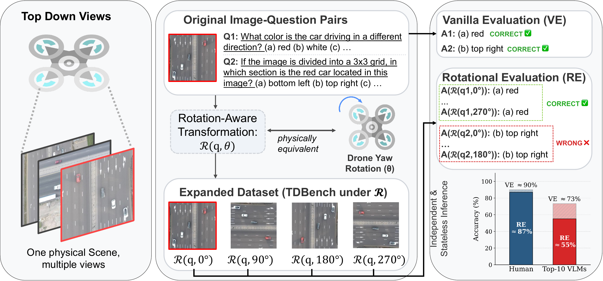
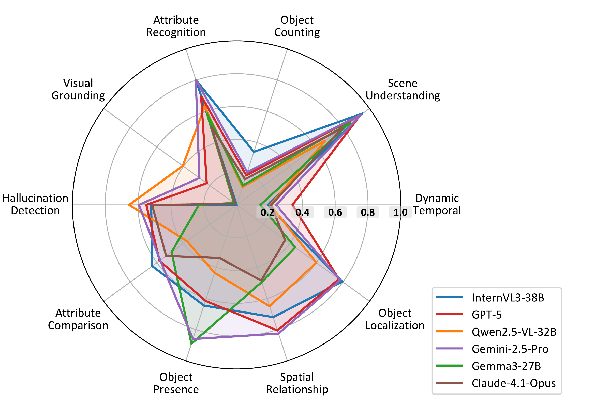
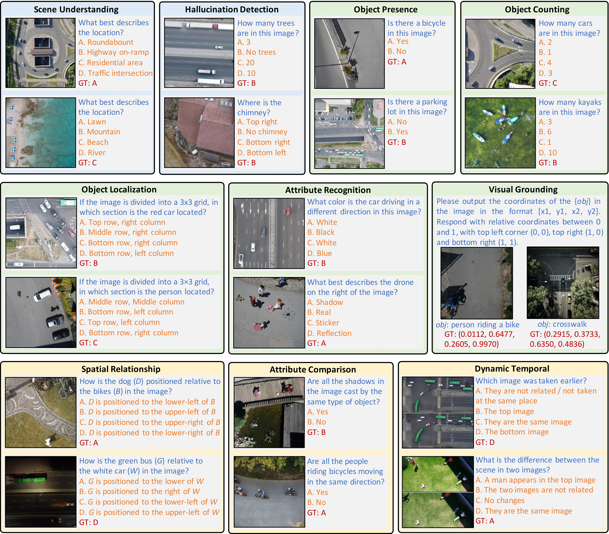
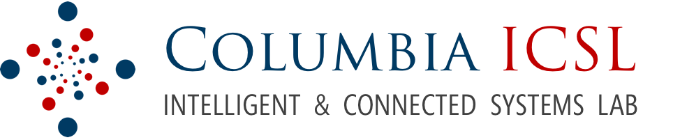

# TDBench: Benchmarking Vision-Language Models in Understanding Top-Down Images

#### [Kaiyuan Hou](https://hou-kaiyuan.github.io/)\*, [Minghui Zhao](https://scottz.net/)\*, [Lilin Xu](https://initxu.github.io/), [Yuang Fan](https://www.linkedin.com/in/yuang-fan/), [Xiaofan Jiang](http://fredjiang.com/)
\* Equally contributing first authors

#### **Intelligent and Connected Systems Lab (ICSL), Columbia University**

[](https://arxiv.org/abs/2504.03748)
[](https://huggingface.co/datasets/Columbia-ICSL/TDBench)

<p align="center">
  
  
</p>

TDBench evaluates vision-language models on top-down (drone-altitude) images: 2,000 questions in 10 categories, each
asked under four image rotations (RotationalEval), plus four case studies (zoom-in, altitude, object integrity, depth).
This repository is a fork of [VLMEvalKit](https://github.com/open-compass/VLMEvalKit), so any model supported by
VLMEvalKit can be evaluated; see [README_VLMEvalKit.md](README_VLMEvalKit.md) for model setup.

## Updates
- **Oct 2026**: data v2 and the `tdbench` command; all four rotations run as one dataset.
- **Sep 2026**: accepted to NeurIPS 2026 (Evaluations & Datasets Track).
- **Apr 2025**: arXiv preprint and dataset released; TDBench added to [VLMEvalKit](https://github.com/open-compass/VLMEvalKit/pull/947).

## Installation

```bash
git clone https://github.com/Columbia-ICSL/TDBench.git && cd TDBench
pip install -e .
```

## Data

Images from ERA and the Semantic Drone Dataset are not hosted with TDBench. Download both from their official pages:

| Dataset | Download |
|---|---|
| ERA | [project page](https://lcmou.github.io/ERA_Dataset/) &rarr; `ERA_Dataset.zip` |
| Semantic Drone Dataset | [project page](https://ivc.tugraz.at/research-project/semantic-drone-dataset/) &rarr; [download](https://cloud.tugraz.at/index.php/s/csxYfaKmie6LyqA) |

Then assemble the benchmark in `$LMUData` (default `~/LMUData`); the rest of the data is downloaded from Hugging Face:

```bash
tdbench build --era /path/to/ERA_Dataset.zip --sdd /path/to/semantic_drone_dataset_semantics_v1.1.zip
```

Both archives can be given as downloaded or as extracted folders.

## Evaluation

```bash
tdbench run main --model Qwen2.5-VL-7B-Instruct
```

| Command | VLMEvalKit datasets | |
|---|---|---|
| `tdbench run main` | `TDBench`, `TDBench_Grounding` | 10 categories, 4 rotations each |
| `tdbench run main --no-grounding` | `TDBench` | the 9 multiple-choice categories |
| `tdbench run case_study` | `TDBench_CS_Zoom`, `TDBench_CS_Height`, `TDBench_CS_Integrity`, `TDBench_CS_Depth` | case studies |
| `tdbench run all` | all of the above | |

Other options are passed to VLMEvalKit's `run.py`, e.g. `--work-dir`, `--api-nproc`, `--reuse`. Answers to
multiple-choice questions are extracted with GPT-4o (`--judge` to change it), so set `OPENAI_API_KEY` as described in
VLMEvalKit. Grounding is scored by whether the centre of the predicted box lies inside the ground-truth box.

Results are written to `<work-dir>/<model>/<run>/`:

| File | Content |
|---|---|
| `<model>_TDBench_main_REresult.csv` | VE and RE for the 10 categories and their average |
| `<model>_TDBench_REresult.csv`, `<model>_TDBench_Grounding_REresult.csv` | the same per dataset |
| `<model>_TDBench_*_result.xlsx` | per-query predictions and scores |

VE is the accuracy on the original images; RE counts a question as correct only if it is answered correctly under all
four rotations.

## Overview

<p align="center">
  
</p>

## Citation

```bibtex
@article{hou2025tdbench,
  title={TDBench: Benchmarking Vision-Language Models in Understanding Top-Down Images},
  author={Hou, Kaiyuan and Zhao, Minghui and Xu, Lilin and Fan, Yuang and Jiang, Xiaofan},
  journal={arXiv preprint arXiv:2504.03748},
  year={2025}
}
```

## Contact

Open an issue, or contact kh3119@columbia.edu or mz2866@columbia.edu.

[](http://icsl.ee.columbia.edu/)
